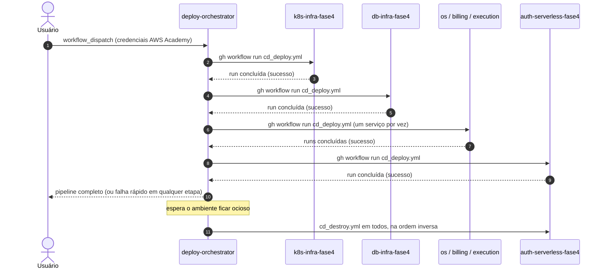

# deploy-orchestrator-fase4

Orquestração de deploy multi-repositório do projeto **Oficina Mecânica** — Fase 4 do Tech Challenge FIAP.

É um repositório auxiliar: não contém infraestrutura própria. Apenas dispara e aguarda, em sequência, o workflow de deploy ou destroy de cada um dos seis repositórios do projeto, recebendo as credenciais efêmeras da sessão AWS Academy **uma única vez**. Depois do deploy, **desliga o ambiente sozinho** quando ele fica ocioso.

Cada microsserviço continua com o seu pipeline de CI/CD independente; o orquestrador é uma conveniência para subir e derrubar o ambiente inteiro. A visão geral da Fase 4 — arquitetura, Saga e os sete repositórios — está no README do [`os-service`](https://github.com/FIAP-15SOAT-GabrielHelton/os-service#arquitetura) e na [RFC-005](https://github.com/FIAP-15SOAT-GabrielHelton/os-service/blob/main/docs/fase4/RFC-005-microsservicos-e-saga.md).

| Repositório | Responsabilidade |
| :--- | :--- |
| [`os-service`](https://github.com/FIAP-15SOAT-GabrielHelton/os-service) | Microsserviço de Ordens de Serviço (cadastros, estoque e ciclo de vida da OS) — PostgreSQL |
| [`billing-service`](https://github.com/FIAP-15SOAT-GabrielHelton/billing-service) | Microsserviço de orçamento e pagamento (Mercado Pago) — PostgreSQL |
| [`execution-service`](https://github.com/FIAP-15SOAT-GabrielHelton/execution-service) | Microsserviço de fila e andamento da execução — MongoDB |
| [`k8s-infra-fase4`](https://github.com/FIAP-15SOAT-GabrielHelton/k8s-infra-fase4) | VPC, EKS, RabbitMQ, MongoDB e New Relic |
| [`db-infra-fase4`](https://github.com/FIAP-15SOAT-GabrielHelton/db-infra-fase4) | RDS PostgreSQL, com usuário e bancos isolados por serviço |
| [`auth-serverless-fase4`](https://github.com/FIAP-15SOAT-GabrielHelton/auth-serverless-fase4) | API Gateway e Lambdas de autenticação/RBAC |
| `deploy-orchestrator-fase4` (este repo) | Deploy e destroy de todos os repositórios, em sequência |

## Tecnologias utilizadas

| Categoria | Tecnologia |
| :--- | :--- |
| CI/CD | GitHub Actions (`workflow_dispatch`) |
| Orquestração | GitHub CLI (`gh workflow run`, `gh run watch`) via script Bash |
| Autenticação cross-repo | Personal Access Token (`ORCHESTRATOR_PAT`) |

## Arquitetura



## Como funciona

`gh workflow run` não é chamável entre repositórios com o `GITHUB_TOKEN` padrão do Actions — por isso este repositório usa um **Personal Access Token** (`ORCHESTRATOR_PAT`, secret) com escopo `repo` + `workflow` nos repositórios de destino.

O script [`.github/scripts/run_and_wait.sh`](.github/scripts/run_and_wait.sh) dispara o workflow (`gh workflow run --repo ...`), localiza a run recém-criada e usa `gh run watch --exit-status` para aguardar a conclusão — se qualquer etapa falhar, a cadeia é interrompida.

### Desligamento automático

O ambiente custa crédito da AWS Academy enquanto está no ar. Por isso, depois do deploy, o job `auto-destroy` roda [`.github/scripts/wait_until_idle.sh`](.github/scripts/wait_until_idle.sh): a cada 10 minutos ele soma as requisições recebidas pelos load balancers (métrica `RequestCount` do CloudWatch) e dispara o destroy de todos os repositórios quando:

- o ambiente passa **30 minutos sem uso**; ou
- completam-se **3 horas** desde o deploy, antes de as credenciais da sessão expirarem.

Rodar o `Destroy All` manualmente cancela um `Deploy All` que esteja nessa espera.

## Contrato de dados entre os repositórios (AWS SSM Parameter Store)

| Parâmetro | Publicado por | Consumido por |
| :--- | :--- | :--- |
| `/oficina-mecanica/vpc_id` | `k8s-infra-fase4` | `db-infra-fase4` |
| `/oficina-mecanica/subnet_ids` | `k8s-infra-fase4` | `db-infra-fase4` |
| `/oficina-mecanica/eks_cluster_name` | `k8s-infra-fase4` | `db-infra-fase4` e os três microsserviços |
| `/oficina-mecanica/rds_address`, `/rds_endpoint` | `db-infra-fase4` | `os-service`, `billing-service` |
| `/oficina-mecanica/rails_api_base_url` | `os-service` | `auth-serverless-fase4` |
| `/oficina-mecanica/billing_api_base_url` | `billing-service` | consulta do endereço público |
| `/oficina-mecanica/execution_api_base_url` | `execution-service` | consulta do endereço público |

## Execução local

Não há aplicação para "rodar" — o script pode ser validado localmente sem disparar nada de verdade:

```bash
bash -n .github/scripts/run_and_wait.sh .github/scripts/wait_until_idle.sh   # checagem de sintaxe
```

Para testar a orquestração de fato, é preciso disparar o workflow `Deploy All`/`Destroy All` (aba **Actions**) com credenciais reais da sessão AWS Academy — não há como simular isso localmente, já que ele chama a API do GitHub para outros repositórios.

## Deploy / Destroy completos

- **`Deploy All`** (`workflow_dispatch`): `k8s-infra-fase4` → `db-infra-fase4` → `os-service` → `billing-service` → `execution-service` → `auth-serverless-fase4`, seguido da espera pelo desligamento automático.
- **`Destroy All`** (`workflow_dispatch`): a mesma lista, na ordem inversa.

Ambos recebem `aws_access_key_id`, `aws_secret_access_key` e `aws_session_token` da sessão AWS Academy (expiram em ~4h) e os repassam para cada repositório disparado.

## Configuração necessária

Secret do repositório: `ORCHESTRATOR_PAT` — Personal Access Token (classic, escopos `repo` + `workflow`, ou fine-grained com `Actions: write` + `Contents: read`) com acesso aos seis repositórios disparados.

Cada repositório continua com seu próprio `workflow_dispatch` independente — este orquestrador é uma conveniência, não uma dependência obrigatória.

## Documentação da API

Este repositório não expõe nenhuma API HTTP — é só orquestração de CI/CD. A documentação das APIs (Swagger/OpenAPI) vive em cada microsserviço: [`os-service`](https://github.com/FIAP-15SOAT-GabrielHelton/os-service#documentação-da-api), [`billing-service`](https://github.com/FIAP-15SOAT-GabrielHelton/billing-service#documentação-da-api) e [`execution-service`](https://github.com/FIAP-15SOAT-GabrielHelton/execution-service#documentação-da-api).
